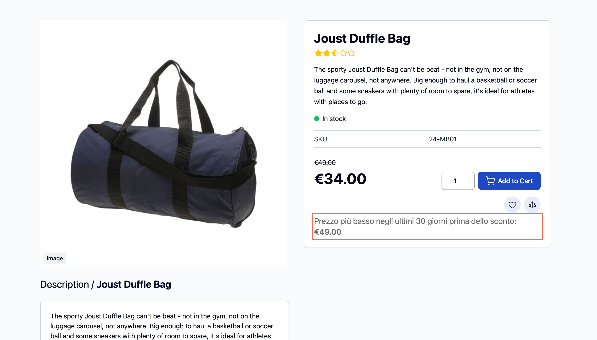
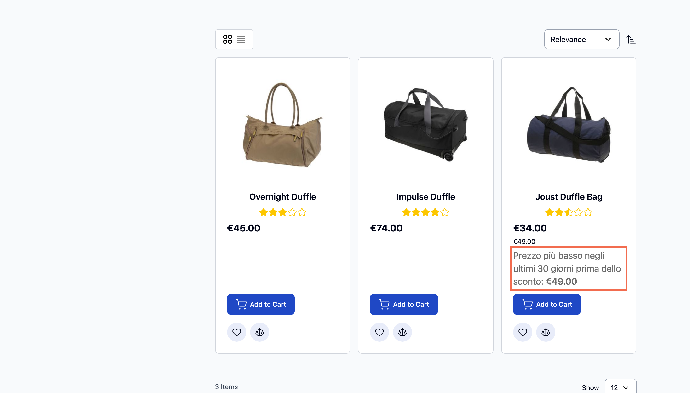
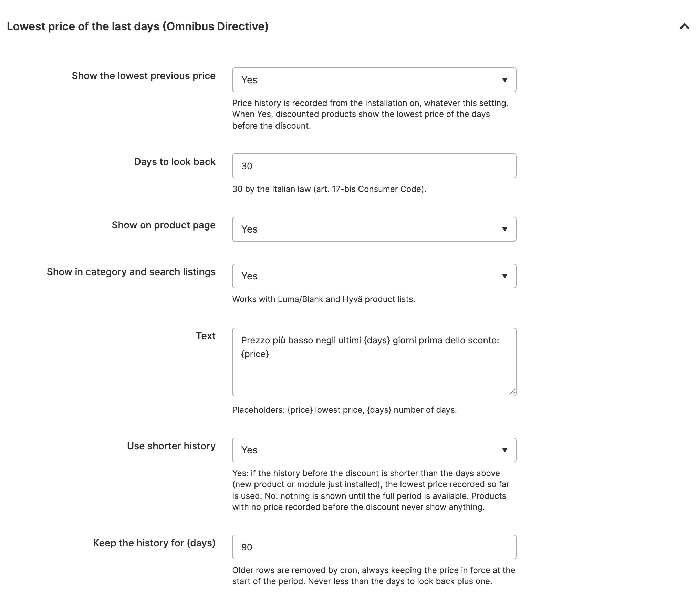

# Threecommerce_Omnibus: EU Omnibus Directive lowest price for Magento 2 / Mage-OS

When a product is on sale, shows the **lowest price of the previous 30 days** under the price, as required by the **EU Omnibus Directive** (2019/2161; in Italy, art. 17-bis of the Consumer Code, Legislative Decree 26/2023). The module records the price history by itself, so nothing is typed by hand.

**Compatibility:** Magento Open Source / Adobe Commerce 2.4.4 – 2.4.9 · Mage-OS 1.x / 3.x · PHP 8.1 – 8.4 · Luma/Blank and Hyvä themes
**License:** commercial · coming soon

## Features

- **Price history** per product and website, recorded at every change of the effective price (product save, hourly cron, CLI command).
- Reads the price from Magento's price index, so **special prices with dates** and **catalog price rules** are already taken into account.
- The reference is the **lowest price of the N days before the discount** (30 by default). With progressive discounts (100 → 80 → 70) it stays the price before the first reduction.
- Shown **only when the current price is really lower** than the reference: no invented data.
- Notice on the **product page** and, optionally, in **category and search listings**, with dedicated **Luma/Blank and Hyvä** templates.
- Price shown **with or without tax**, like the rest of the catalog.
- Editable text with `{price}` and `{days}` placeholders, configurable **per store view**.
- **Off by default** (history is recorded from the first day anyway), and old history is cleaned up by cron.

## Requirements

- Magento Open Source / Adobe Commerce 2.4.4+ or Mage-OS
- PHP 8.1 – 8.4
- Package: `threecommerce/m2-base`
- Magento cron running on the server, price indexers up to date

## Limitations

The history starts at installation and cannot be rebuilt for the past: a product already on sale when the module is installed shows the notice only after a later price change. Configurable, bundle and grouped products use the parent "from" price; tier prices and customer-group prices are not tracked; the cart and mini-cart do not show the notice. The module is a technical tool: commercial choices and compliance remain the merchant's responsibility.

## Availability

This module is **not yet available to buy**. It is a commercial product and is coming soon. To be notified when it is released, or to ask for details, use the [product page](https://www.threecommerce.it/omnibus-magento-2?utm_source=github&utm_medium=readme&utm_campaign=magento2-omnibus) or [get in touch](https://www.threecommerce.it/contatti?utm_source=github&utm_medium=readme&utm_campaign=magento2-omnibus).

## Configuration

*Stores → Configuration → Threecommerce Plugins → Omnibus*: enable the notice, days to look back, product page and listings, text, shorter history option and history retention.

## Documentation and support

- Product page: [threecommerce.it/omnibus-magento-2](https://www.threecommerce.it/omnibus-magento-2?utm_source=github&utm_medium=readme&utm_campaign=magento2-omnibus)
- [Changelog](CHANGELOG.md)
- Support and custom development: [threecommerce.it/contatti](https://www.threecommerce.it/contatti?utm_source=github&utm_medium=readme&utm_campaign=magento2-omnibus)

---

*This repository is the public showcase of the module. The source code is kept in a private repository.*
